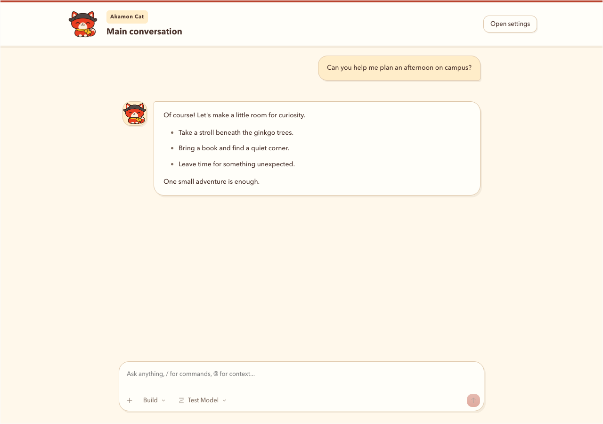
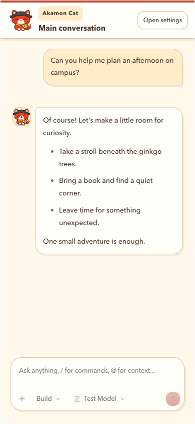
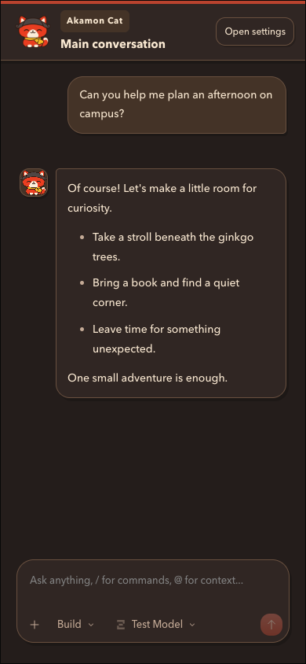

# Akamon Cat chat theme

The single-session browser chat uses the selected transparent Akamon Cat artwork in its header, empty state, and beside assistant replies. Cream paper, vermilion accents, ginkgo gold, rounded speech bubbles, and warm outlines carry the character's visual style into the chat. Dark mode uses the same palette on charcoal brown surfaces.

All theme rules are scoped to the single-session shell. The full browser UI (`VITE_OPENCODE_UI_MODE=full`) and desktop appearance are unchanged. Session persistence, streaming, model selection, attachments, send/stop, and permission/question handling retain their existing implementation. No backend, agent prompts, API, schema, or dependency changes are included.

The original RGBA artwork is stored unchanged in `src/assets/akamon-cat.png`. Vite bundles it locally and shares the asset URL between the header, empty state, and decorative assistant portraits. There are no external image or font requests.

## Screenshots

These screenshots use deterministic example messages, not a live model or private conversation.

| Mobile                                        | Dark mode                                        |
| --------------------------------------------- | ------------------------------------------------ |
|  |  |

## Verification

- App and E2E typechecks; production build.
- 13 single-session browser tests, including both composer layouts, light/dark mode, 1280px and 390px viewports, loaded mascot artwork, streaming portraits, send/stop, persistence, model selection, and request responses.
- 4 full-UI regression tests for permission/question docks, draft-caret restoration, and hidden terminals.
- 11 focused unit tests for session persistence and command policy.
- Production streaming benchmark before/after: 40 historical turns, 80 deltas, CPU throttle 1; no blank samples, timeline/Markdown remounts, or bottom drift.

Browser checks ran in the installed Chrome browser with video disabled using temporary external Playwright configs; application code and test behavior were unchanged by those overrides. These checks use deterministic backend fixtures and do not make paid model requests.

| Production benchmark         |    Before |    Themed |
| ---------------------------- | --------: | --------: |
| Completion observed          | 21,609 ms | 20,599 ms |
| Delivered deltas             |        80 |        80 |
| Blank samples / bottom drift |     0 / 0 |     0 / 0 |
| Timeline / Markdown remounts |     0 / 0 |     0 / 0 |

These are single local runs, not evidence of a speed improvement. [Raw benchmark metrics](akamon-chat-benchmark.json) preserve the comparison.
